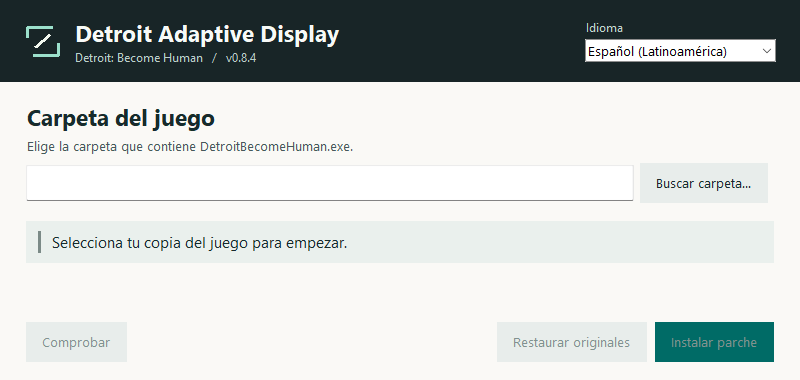
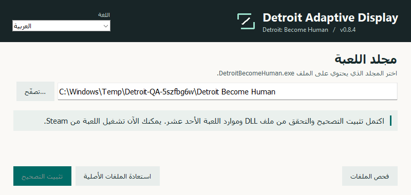
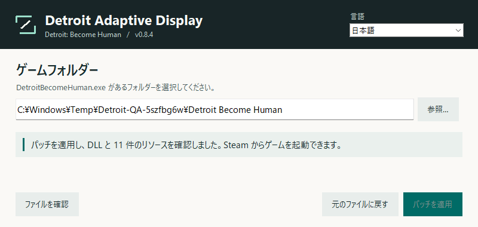
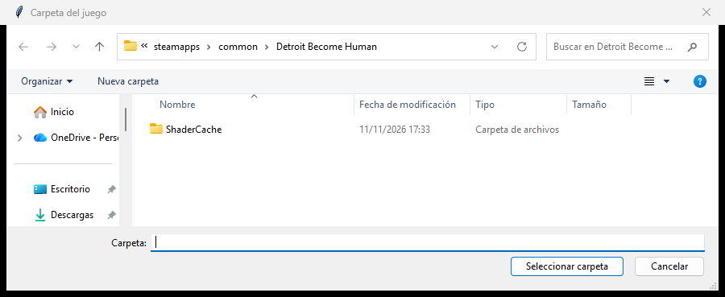
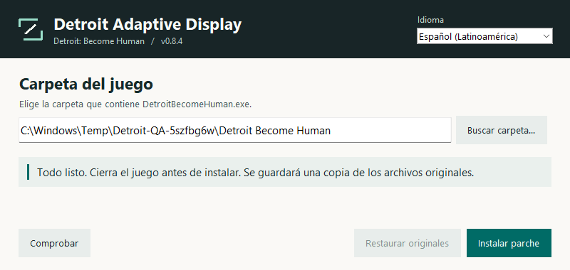
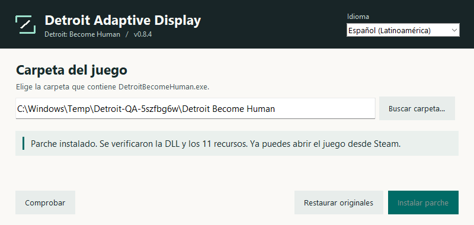
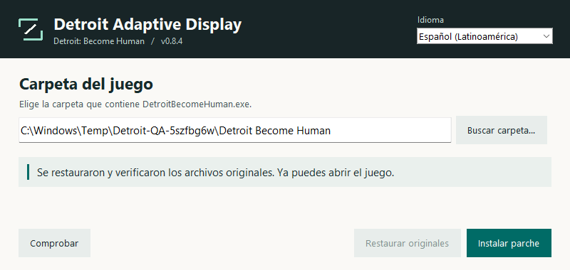
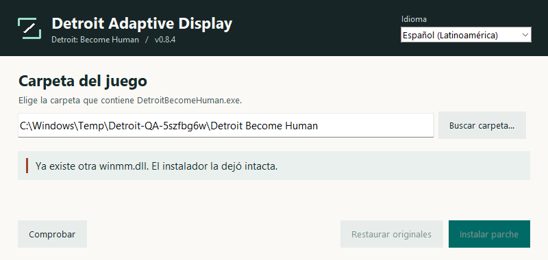

# Instalar Detroit Adaptive Display 0.8.4

Necesitas Windows de 64 bits, una copia compatible de *Detroit: Become Human* y permiso de escritura en la carpeta del juego. El instalador incluido en el ZIP lleva todo lo necesario. Las capturas de esta guía corresponden a una instalación y una restauración reales en una copia de prueba de los archivos afectados.

## 1. Abre el instalador y elige tu idioma

Extrae los dos archivos del ZIP juntos en una carpeta de tu elección. Abre **DetroitAdaptiveDisplay-Setup.exe** y deja **DetroitAdaptiveDisplay.SetupData.dll** en esa misma carpeta. En **Idioma**, elige **Español (Latinoamérica)**, **Español (España)** u otro de los 25 idiomas. Puedes cambiarlo mientras el instalador está abierto. Esta selección solo se aplica al instalador.

Ver el mismo instalador en árabe y japonés

## 2. Selecciona y comprueba la carpeta del juego

En Steam, abre la biblioteca, haz clic derecho en el juego y selecciona **Administrar → Ver archivos locales**. Localiza la carpeta que contiene `DetroitBecomeHuman.exe`.

Pulsa **Buscar carpeta…** para abrir el selector de carpetas de Windows. Puedes navegar con el panel lateral o pegar la ruta en la barra de direcciones y pulsar **Intro**. Con la carpeta del juego abierta, confirma la selección. El instalador comprobará los archivos automáticamente. Si cancelas, se conserva la ruta anterior.

El título del selector usa el idioma del instalador. Windows muestra los controles del Explorador en el idioma del sistema. También puedes pegar la ruta directamente en el instalador y pulsar **Comprobar**.

Si eliges `ShaderCache` u otra subcarpeta, el instalador sube hasta `DetroitBecomeHuman.exe` y muestra la carpeta del juego. Cuando aparece **Todo listo**, están disponibles la integración del motor y los 11 recursos del parche completo. Si aparece **Se pueden instalar los ajustes de menús e indicadores compatibles**, puedes instalar los ajustes de interfaz reconocidos en esa copia. Se mantienen los ajustes de cámara, video y FPS del juego.

## 3. Instala el parche

Cierra el juego desde **Regresar al escritorio** y pulsa **Instalar parche**. El instalador genera los recursos a partir de tu copia, guarda el índice y el paquete originales y verifica los archivos que acaba de escribir. Espera el mensaje de instalación completada antes de abrir el juego.

Puedes usar **Instalar parche** si ya lo aplicaste. Cuando los archivos coinciden con una instalación reconocida, la comprobación confirma que el parche está presente y reutiliza la copia de seguridad existente.

La copia de restauración está en `DetroitAdaptiveDisplay.backup`, dentro de la carpeta del juego. Consérvala mientras uses el parche.

## 4. Restaura los archivos originales

Cierra el juego, abre el instalador y vuelve a seleccionar la misma carpeta. Pulsa **Restaurar originales**. El instalador repone el índice y el paquete que figuran en la copia de seguridad, y verifica sus huellas originales. Si instalaste el parche completo, también retira la DLL que agregó.

## Si se detecta un conflicto

| Mensaje o situación | Qué hacer |
| --- | --- |
| Ya existe otra `winmm.dll` | Identifica qué mod la instaló. El instalador conserva esa DLL. Si decides retirar el otro mod, utiliza su procedimiento de desinstalación antes de volver a comprobar. |
| Se solicita la carpeta del juego | Selecciona la carpeta que contiene `DetroitBecomeHuman.exe` o una de sus subcarpetas. |
| No se reconocieron menús ni indicadores compatibles | Los archivos de interfaz de esa edición o mod necesitan una adaptación. La comprobación conserva los archivos del juego. |
| El juego sigue abierto o la carpeta está bloqueada | Cierra el juego y vuelve a intentarlo. Comprueba que tu cuenta tenga acceso de escritura a la carpeta. |
| Hay una instalación pendiente | Usa **Restaurar originales** para recuperar la copia guardada. Después vuelve a comprobar la carpeta. |
| Los archivos cambiaron después de instalar | El instalador conserva los cambios y la copia de seguridad. Comprueba si Steam actualizó el juego o si otro mod modificó el índice o el paquete. |

## Qué se comprobó

La copia disponible para la prueba pertenece a Steam. Las pruebas de instalación y restauración se realizan en copias aisladas de los recursos. Se comprueban también cambios de metadatos del ejecutable, cambios en la imagen del motor, recursos trasladados, una DLL ajena y archivos de interfaz desconocidos. La prueba con datos de otra compilación es simulada. La validación visual en otras ediciones comerciales sigue pendiente.
